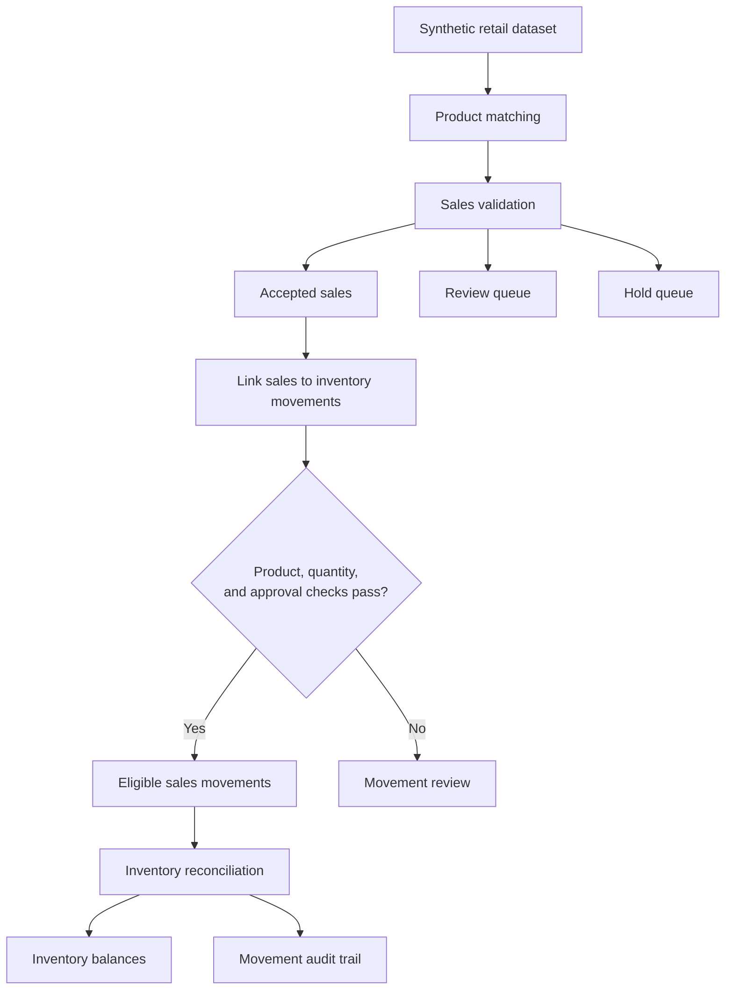

# Dylte Wears: Sales Validation & Inventory Reconciliation

**A Python-based retail data quality and inventory control prototype.**

Retail sales records can contain missing SKUs, ambiguous product descriptions, incomplete variants, and invalid quantities. This project explores how to validate those records, route uncertain cases for human review, and prevent unverified sales from silently changing inventory balances.

**The core principle:** Validate first. Review uncertainty. Reconcile only eligible movements.

### Project at a glance

| | |
|---|---|
| **Dataset** | 800 synthetic sales lines |
| **Validation outcomes** | 111 accepted · 677 review · 12 hold |
| **Integrated workflow** | 56 eligible sales movements |
| **Automated tests** | 27 passing |
| **Tools** | Python · pandas · pytest |

*All results use synthetic data and demonstrate the configured prototype rules, not measured real-world business performance.*

### What this project demonstrates

- Rule-based SKU and product-description matching.
- Data-quality checks and decision queues.
- Validation of sales-to-inventory movement consistency.
- Inventory reconciliation with auditable decisions.
- Automated tests for matching, validation, and integration rules.

## Technology Stack

- Python
- pandas
- Excel and CSV data files
- pytest
- Git and GitHub for version control and project sharing

## Workflow

1. **Load synthetic data:** Read the product catalogue, aliases, sales records, opening stock, and stock movements.
2. **Match products:** Match known SKUs and generate candidate products for missing-SKU records.
3. **Validate sales:** Apply rules covering quantities, product identity, colour consistency, and uncertain size formats.
4. **Route decisions:** Separate accepted sales, records requiring review, and records placed on hold.
5. **Check movement eligibility:** Link sales movements to validation results and verify product, quantity, and approval consistency.
6. **Reconcile inventory:** Pass eligible sales movements and retained non-sale movements through the inventory reconciliation rules.
7. **Evaluate and test:** Generate audit outputs and run automated tests covering matching, validation, and integration decisions.

## System Architecture

The workflow separates sales validation from inventory movement eligibility. Uncertain records are routed for review, and only sales movements that satisfy the integration checks are passed to inventory reconciliation.



**Control principle:** A sale being accepted by the validation pipeline does not automatically guarantee that its inventory movement is eligible. The integration checks must also pass.

## Synthetic Dataset

The workbook contains:

- 300 catalogue products
- 636 product aliases
- 800 sales lines
- 150 stock receipts
- 30 stock adjustments
- 800 evaluation labels for synthetic matching analysis
- 46 pilot test cases
- 8 adversarial cases

The dataset is synthetic. Results should not be interpreted as evidence of performance on real retail transactions.

## Current Results

On the current synthetic dataset, the sales validation pipeline produced:

| Processing outcome | Records |
|---|---:|
| Accepted | 111 |
| Requires review | 677 |
| On hold | 12 |
| **Total sales lines** | **800** |

The integrated workflow processed 473 original inventory movement records:

| Integration measure | Records |
|---|---:|
| Sales movements | 338 |
| Eligible sales movements | 56 |
| Sales movements requiring review | 282 |

The integrated inventory movement audit reported 184 applied movements and 7 movements requiring review.

These figures describe the current synthetic dataset and configured rules. They do not demonstrate real-world accuracy, time savings, or production performance.

## Safety and Control Design

- Ambiguous product matches are not automatically accepted.
- Numeric size values are not silently converted to catalogue size labels when their meaning is uncertain.
- Sales must pass validation and match their corresponding movement in product and quantity.
- Sales movements must meet the configured approval condition before becoming eligible.
- The inventory reconciliation module retains its own movement validation rules.
- Audit outputs preserve decisions and reasons for inspection.

## Project Structure

```text
dylte-wears-automation/
├── data/
│   └── dylte_wears_synthetic_automation_dataset.xlsx
├── outputs/
│   ├── accepted_sales.csv
│   ├── review_queue.csv
│   ├── hold_queue.csv
│   ├── validation_results.csv
│   ├── integrated_sales_movement_audit.csv
│   ├── integrated_inventory_balances.csv
│   └── integrated_inventory_movement_audit.csv
├── src/
│   ├── candidate_matching.py
│   ├── matching.py
│   ├── run_sku_matching.py
│   ├── run_validation.py
│   ├── integration_rules.py
│   ├── integrated_reconciliation.py
│   ├── reconcile_inventory.py
│   └── test_*.py
├── data_quality_rules.md
├── requirements.txt
└── README.md
```

Additional exploratory and evaluation scripts are retained in `src/`.

## Setup

Python 3.9 or a compatible version is required.

Create and activate a virtual environment:

```bash
python3 -m venv .venv
source .venv/bin/activate
```

Install dependencies:

```bash
python -m pip install -r requirements.txt
```

## Run the Workflow

Run sales validation:

```bash
python src/run_validation.py
```

Then run integrated inventory reconciliation:

```bash
python src/integrated_reconciliation.py
```

Run the automated tests:

```bash
python -m pytest src -v
```

The integration script expects the validation output to exist before it runs.

## Limitations

- The data is synthetic and does not represent a live retail operation.
- The workflow has not been validated against real-world business data.
- Candidate matching is constrained by the catalogue, aliases, and configured rules.
- Records requiring review still need an appropriate human decision process.
- The project is a controlled prototype, not a production inventory system.
- The reported outputs do not establish measured business savings or operational impact.

## Future Improvements

- Add a repeatable end-to-end test that runs the pipeline from fresh inputs.
- Improve configuration and reproducibility by pinning tested dependency versions.
- Add explicit tests for malformed inputs and additional inventory edge cases.
- Create a concise workflow diagram and a documented evaluation methodology.
- Assess the workflow against appropriately anonymized real data if authorized access becomes available.

## 👩🏽‍💻 Author

**Gloria Austin**  
*Business Intelligence Analyst | Data Analyst*

**Core Competencies:**  
`Business Intelligence` | `Data Analytics` | `Power BI` | `DAX` | `SQL` | `PostgreSQL` | `Excel` | `KPI Development` | `Executive Reporting`